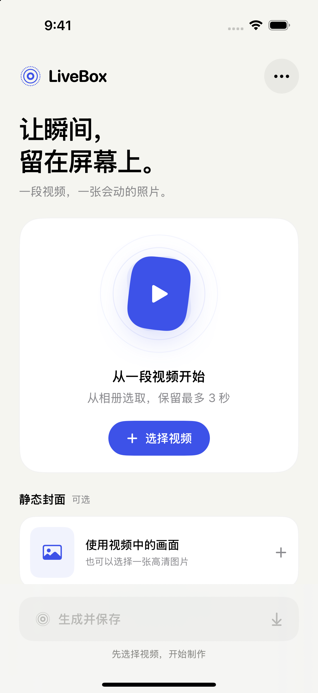

# LiveBox

SwiftUI iOS App，将视频生成 Live Photo 并保存到系统相册，可用于动态锁屏。最低 iOS 18，无第三方运行时依赖。纯元数据模板采用 MIT 许可，见 ThirdPartyNotices.md。

## App 截图



截图来自 iPhone 16 Pro 模拟器。

## 应用信息

- 显示名称：LiveBox
- 版本：1.0.0，构建号：1（Debug / Release 一致）
- Bundle ID：`com.sxrong.LiveBox`
- 支持 iPhone / iPad，最低 iOS 18.0，默认语言为简体中文
- App Icon：`LiveBox/Assets.xcassets/AppIcon.appiconset/AppIcon.png`

版本号通过 Xcode Target 的 Marketing Version 管理，构建号通过 Current Project Version 管理；App 内「帮助与工具」读取安装包中的实际版本。

## 安装

```bash
git clone https://github.com/Gitawake/LiveBox.git
cd LiveBox
open LiveBox.xcodeproj
```

在 Xcode 中选择自己的开发团队，并根据需要修改 Bundle ID，选择目标 iPhone 运行。首次生成时允许添加照片。

## 打包 IPA

项目内置 `tools/build-ipa`，使用 macOS、完整 Xcode 和 Python 3 编译 Release 真机版本，并生成未签名 IPA：

```bash
python3 tools/build-ipa .
```

默认输出为 `build/ipa/LiveBox.ipa`。可指定 Scheme 和输出路径：

```bash
python3 tools/build-ipa . --scheme LiveBox --output build/ipa/LiveBox-1.0.0.ipa
```

也可在其他目录调用脚本，传入本项目的绝对路径。构建过程中使用临时目录，结束后自动清理；构建失败不会覆盖之前的 IPA。生成的 IPA 需要通过侧载工具签名后安装，不是用于 App Store 上传的签名归档。

## GitHub 自动构建

进入仓库 **Actions → Build IPA → Run workflow**，选择 `main` 并运行。构建成功后，在该次运行页面的 **Artifacts** 下载 `LiveBox-unsigned-ipa-运行编号`，解压得到 `LiveBox.ipa`。产物保留 30 天。

推送以 `v` 开头的版本标签（例如 `v1.0.0`）也会自动构建。普通代码提交不触发打包。流程使用 GitHub 的 macOS 运行器和仓库内打包脚本，无需上传 Apple 证书或配置签名 Secrets。输出仍为未签名 IPA，需另行签名后安装。

## 使用

App 只有一个生成模式。选择视频，可拖动固定 3 秒选框选择片段，短视频使用全部可用画面。图片封面可选；点击“使用视频帧作封面”可清除所选图片。

自选图片仅保存为独立静态 HEIC 封面，保留原始像素尺寸（应用方向）及可用拍摄元数据，不插入或替换任何视频帧。不选图片时从视频标记帧提取封面。图片和视频使用同一配对标识。图片重新编码为最高质量 HEIC，不保证数学无损。自选图片与视频内容不同时，系统从静态封面进入或退出播放仍可能出现视觉跳变；动态壁纸资格需真机验证。保留源视频实际帧时间及声音。

快捷指令中添加“生成 Live Photo”，绑定必选视频变量与可选图片变量；使用视频开头最多 3 秒，生成后直接保存相册。无需打开 App，也无需额外保存动作。

## 处理与验证

输出为 HEVC MOV 与 HEIC 封面。封面时间位于片段中点后的首个可用帧，添加逐帧动态元数据与 still-image-time，照片与视频使用同一 UUID。音频按同一裁剪范围处理，方向渲染到实际像素。所有处理在本机完成，临时文件在完成或失败后清理。

运行本地媒体回归：`python3 Tests/run_video_regression.py`。验证 30/60 fps、完整画面时间轴、裁剪起点、短视频、竖屏、独立图片封面、全部视频帧保持源画面、未选图片时 HEIC 与标记帧一致、音轨保留及同步、元数据时间和轨道引用。测试不写入系统相册。构建使用 Xcode 的 iOS Simulator SDK；锁屏资格与播放效果仍需真机验收。

## 锁屏兼容性

[Apple 锁屏说明](https://support.apple.com/120734)没有公布完整文件判定规范。动态元数据方案参考 [live-photo-batch](https://github.com/pudding0503/live-photo-batch)，本项目保留源帧率与音轨，并支持单帧图片封面，不能把参考项目的实测结果视为本配置的兼容性保证。

在设置中添加新生成的 Live Photo 壁纸，确认动态按钮能开启并唤醒锁屏观察。锁屏只播放一段是用户在 iPhone 16 Pro / iOS 27.0.1 上通过系统相机 Live Photo 对照确认的行为，不以完整播放 3 秒作为验收条件。任意独立封面可能影响系统的动态效果判定，需用实际素材验证。旧版已保存文件不会自动改变。

已撤销强制 HDR → SDR Rec.709 转换。用户在 iPhone 16 Pro / iOS 27.0.1 上反馈 4K 素材无论 HDR 开关均无法启用动态效果，而 1080p 可用；这属于设备反馈，不是 Apple 公布的分辨率限制。当前按相机样本的视频尺寸自动缩小较大视频。现有像素与封面处理不保证完整保留 HDR／杜比视界信息。

所有入口自动将视频保持比例缩小到长边不超过 1920、短边不超过 1440 的范围，不放大小视频；输出尺寸取偶数。4:3 横屏最大 1920×1440，竖屏最大 1440×1920；16:9 的 4K 视频输出 1920×1080。独立图片封面的像素尺寸不受视频缩小影响。帧率、声音、封面时间及元数据沿用此前处理方式。此尺寸来自提供的相机样本，不是 Apple 公布的强制标准，也不保证所有素材的锁屏资格。

用户提供的相机原生样本 IMG_2902：HEIC 为 4032×3024；视频为 1920×1440，具有竖屏旋转信息，69 帧、约 2.83 秒，并非固定 60 fps。高分辨率静态资源与较低分辨率动态资源可以配对。1080p 是本项目用户设备上的实测兼容策略，不应描述为所有 Live Photo 资源的官方尺寸上限。

结构对照见 Diagnostics/Camera-LivePhoto-structure.md。当前仅实现可从素材还原的基础配对与时间结构，不伪造相机辅助图像、真实运动传感器或 Smart Styles 数据。动态元数据的私有内容仍使用参考模板，不能声称与系统直出完全相同。

排查动态按钮不可用时，App 内可导出最近生成的 HEIC、MOV 和参数报告。文件检查可以识别损坏、配对或时间轴错误，不能直接证明 iOS 锁屏资格。真实素材检查脚本：`python3 Tests/inspect_real_video.py 输入视频 全新输出目录 [起点秒数] [可选封面]`。

## 许可证

项目采用 [MIT License](LICENSE)。第三方动态元数据模板的许可与归属见 [ThirdPartyNotices.md](ThirdPartyNotices.md)。
